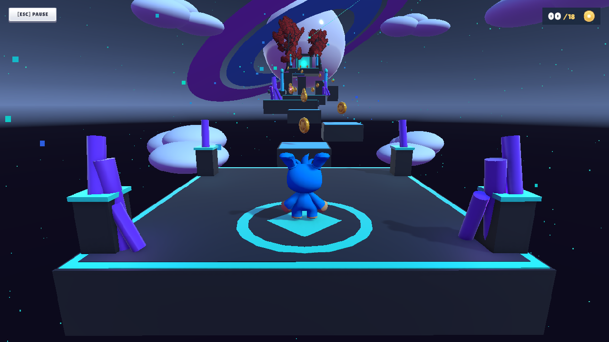
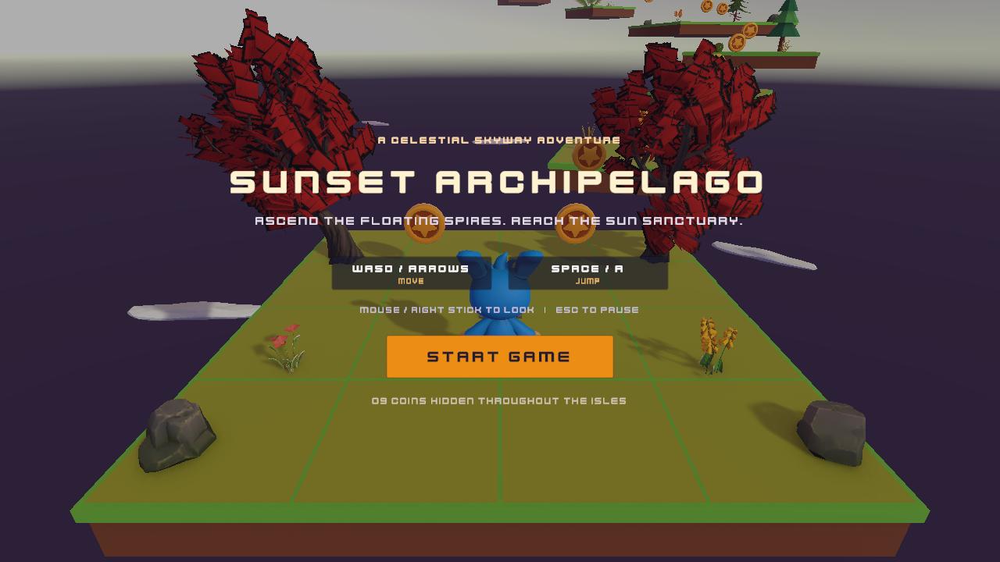
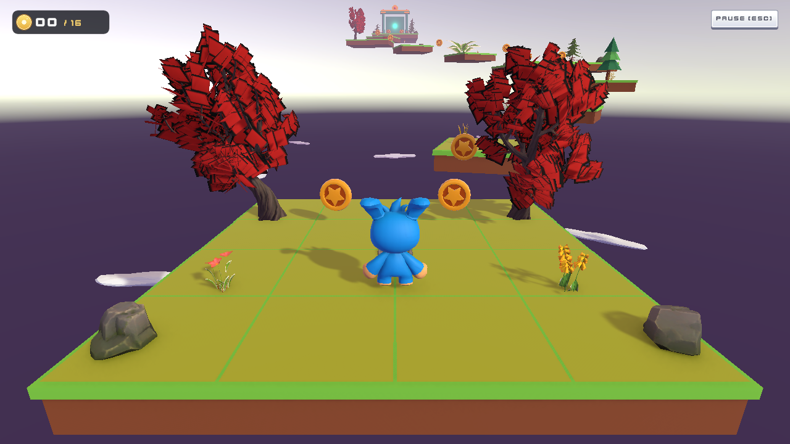
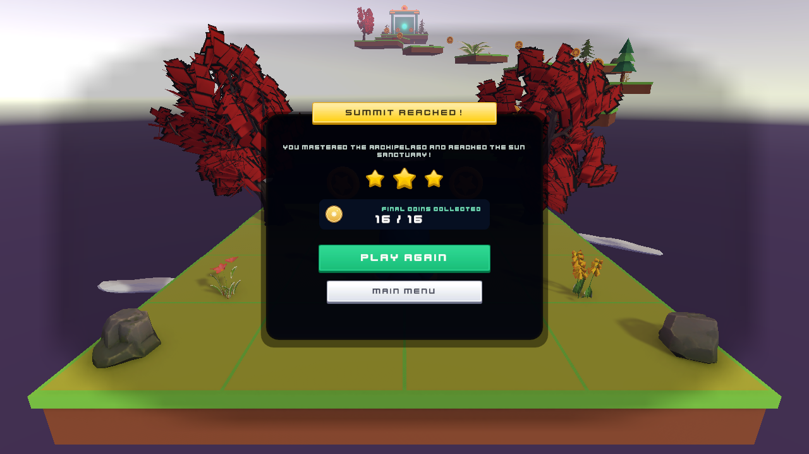

# Cloudstep: 3D Precision Platformer

[](https://unity.com/)
[-magenta.svg)](https://unity.com/features/universal-render-pipeline)
[](https://docs.microsoft.com/dotnet/csharp/)
[](https://docs.unity3d.com/Packages/com.unity.inputsystem@latest)
[](LICENSE)

A high-performance, stylized 3D platformer featuring responsive camera-relative kinematics, precision jump buffering, coyote time, kinematic moving platform synchronization, and a zero-allocation audio architecture built with **Unity 6** and the **Universal Render Pipeline (URP)**.

---

## 🎮 Gameplay Showcase

| Neon Spireway (Level 03) | Sunset Archipelago (Level 02) |
| :---: | :---: |
|  |  |

| In-Game HUD & Collectibles | Victory & Level Progression |
| :---: | :---: |
|  |  |

---

## ✨ Key Features & Technical Highlights

### 🏃 Precision Character Kinematics & Game Feel
- **Camera-Relative Omnidirectional Movement**: Smoothly calculates player heading relative to camera boom yaw while preserving full analog stick and WASD fidelity.
- **Coyote Time (100ms tolerance)**: Allows players to execute jumps for a fraction of a second after stepping off platform ledges, eliminating "unfair" falling deaths.
- **Jump Buffering (120ms window)**: Caches jump inputs pressed just before touching the ground, delivering immediate, responsive jumps upon landing.
- **Ground Snapping & Sphere Cast Verification**: Dual ground-checking combining `CharacterController.isGrounded` with an offset sphere cast to eliminate bounce and false ungrounded triggers on slopes.
- **Dynamic Procedural Audio & Animation Hooks**: Dispatches landing velocity and horizontal movement delta directly to animation and sound emitters without runtime garbage collection.

### 🚀 Kinematic Platform Synchronization
- **CharacterController Rider Locking**: Overcomes the classic Unity limitation where `CharacterController` does not inherit kinematic platform movement. The `MovingPlatform` controller tracks rider triggers and continuously translates the player via `CharacterController.Move(delta)`.
- **SmoothStep Oscillation**: Procedural ease-in and ease-out interpolation with configurable endpoint dwell timers.
- **Dynamic 3D Audio Hum**: Real-time Doppler and distance-attenuated mechanical hum with lower volume during platform wait states.

### 🎥 Collision-Aware 3rd-Person Orbit Camera
- **Dynamic Obstacle Occlusion**: Spherical raycasts detect obstructing level geometry between player and camera pivot, dynamically tightening distance to eliminate camera clipping into walls.
- **Pitch & Yaw Isolation**: Player rotation does not rotate the camera boom, keeping platform navigation predictable and nausea-free.
- **Dual Input Architecture**: Seamlessly handles high-DPI mouse delta input alongside normalized gamepad right-stick rotational velocity.

### 🔊 Production-Grade Audio Architecture
- **Zero-Allocation SFX Object Pooling**: Pre-instantiated emitter pool dynamically recycles `AudioSourceEmitter` components, eliminating `Instantiate()` and `Destroy()` garbage collection hitches during intense gameplay.
- **Dual-Channel BGM & Ambience Crossfader**: Smooth coroutine-based crossfading across multiple audio channels.
- **Logarithmic Decibel Conversion**: Mathematically accurate `20 * log10(volume)` audio curve mapping linear slider inputs to perceived human hearing volume.
- **PlayerPrefs Persistence & Event Bus**: Centralized `AudioManager` singleton synchronizes state with runtime UI sliders and saves player audio preferences across game restarts.

### 🕹️ Multi-Level Flow & State Management
- **Finite State Machine (FSM)**: Strict game loop transitions across `MainMenu`, `Playing`, `Paused`, `Dead`, and `Won` states.
- **Seamless Scene Transitions**: Retains auto-start run states across scene loads (`AutoStartRunKey`), automatically transitioning players directly into gameplay on subsequent levels.
- **Reactive UI**: Smooth `CanvasGroup` alpha fading, interactive button audio hooks, and animated pulsing collectible HUD indicators.

---

## 🗺️ Levels & Biomes

1. **Level 01: Cloud Meadow (Tutorial / Onboarding)**
   - Introduces core movement, coin collection, jump timing, and basic verticality.
2. **Level 02: Sunset Archipelago**
   - High-contrast warm sunset lighting over oceanic spires.
   - Features timing-critical moving platforms over abyss gaps.
3. **Level 03: Neon Spireway**
   - Cyberpunk-inspired vertical speedway featuring floating neon beams, intricate jumps, and starfield skybox aesthetics.

---

## 🕹️ Controls

| Action | Keyboard & Mouse | Gamepad |
| :--- | :--- | :--- |
| **Move** | `W` / `A` / `S` / `D` or `Arrow Keys` | `Left Stick` |
| **Jump** | `Spacebar` | `Button South (A / Cross)` |
| **Look / Orbit** | `Mouse Delta` | `Right Stick` |
| **Pause / Resume** | `Escape` / `P` | `Start / Options` |
| **UI Navigate** | `Mouse Pointer` | `D-Pad / Left Stick` |

---

## 🏗️ Technical Architecture & Project Structure

```
Assets/_Project/
├── Animations/       # Player animator controller & state transitions
├── Art/
│   ├── External/     # Modular stylized environment models & clouds
│   ├── Generated/    # Custom lighting & reflection probes
│   └── UI/           # Textures, sprites, and iconography
├── Audio/
│   ├── Ambience/     # Environmental looping tracks
│   ├── BGM/          # Dynamic background music tracks
│   ├── Data/         # SoundDataSO ScriptableObject definitions
│   ├── Mixers/       # Master, SFX, BGM, Ambience, and UI mixer routing
│   └── SFX/          # Footsteps, jumps, lands, coin pickups, platform hum
├── Materials/        # URP lit materials, neon emission shaders, glass shaders
├── Prefabs/          # Player prefab, moving platforms, coin pickups, UI screens
├── Scenes/           # Level01, Level02_SunsetArchipelago, Level03_NeonSpireway
├── Scripts/
│   ├── Audio/        # AudioManager, AudioSourceEmitter, SoundDataSO, AudioSettingsUI
│   ├── CameraFollow.cs           # Collision-aware 3rd-person camera boom
│   ├── PlayerController.cs       # Kinematics, jump buffer, coyote time
│   ├── MovingPlatform.cs         # Oscillating platform with rider tracking
│   ├── GameManager.cs            # FSM game loop, UI management, progression
│   ├── CoinPickup.cs             # Collectible collision & audio dispatch
│   └── SafeAreaCornerAnchor.cs   # Multi-resolution UI safe area anchoring
└── Textures/         # Custom starfield particles, UI textures, FX
```

---

## 🚀 Getting Started

### Prerequisites
- **Unity Hub**: Recommended version **Unity 6000.6.4f1** (or any compatible Unity 6.x release).
- **Git** with support for standard Git workflows.

### Installation
1. **Clone the repository**:
   ```bash
   git clone https://github.com/<your-username>/<repo-name>.git
   cd <repo-name>
   ```

2. **Open the Project**:
   - Open **Unity Hub**.
   - Click **Add** -> **Add project from disk**.
   - Select the cloned project directory.
   - Ensure the Editor version is set to **Unity 6 (6000.6.4f1)**.

3. **Play the Game**:
   - In the Project window, navigate to: `Assets/_Project/Scenes/Level01.unity`.
   - Double-click to open the scene.
   - Press the **Play** button in the Unity Editor toolbar.

---

## 🛠️ Built With

- **Engine**: [Unity 6 (6000.6.4f1)](https://unity.com/)
- **Render Pipeline**: Universal Render Pipeline (URP 17.6)
- **Input System**: Unity New Input System package (`com.unity.inputsystem`)
- **Text Rendering**: TextMeshPro (`com.unity.ugui`)
- **Audio Routing**: Unity AudioMixer with custom decibel conversion curves
- **3D Assets**: Stylized assets by [Quaternius](https://quaternius.com/) (CC0 / Permissive)

---

## 📄 License

This project is licensed under the MIT License - see the [LICENSE](LICENSE) file for details.
All external 3D art assets are provided under permissive/CC0 terms by Quaternius.
